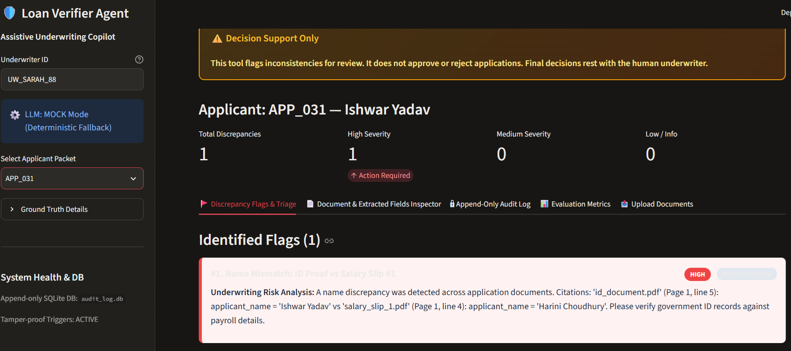
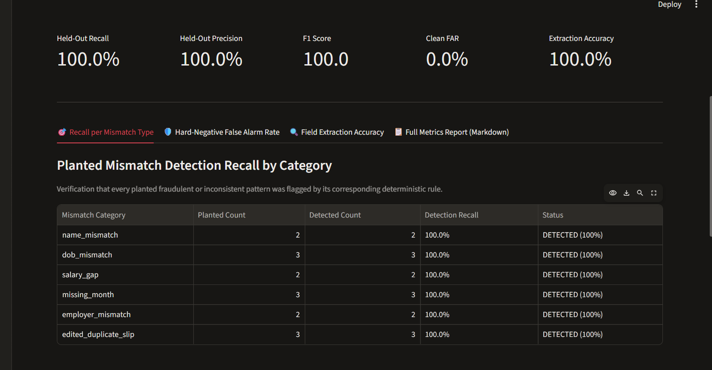
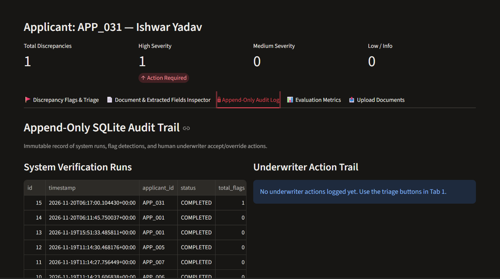
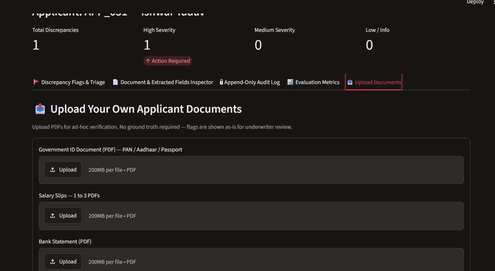
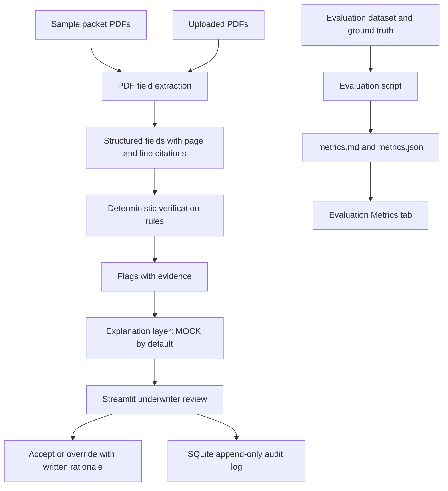

# AI Loan Document Verifier

## Screenshots

### Flags with evidence


### Evaluation metrics


### Append-only audit log


### Upload documents


## Problem

Reviewing an applicant's identity proof, salary slips, and bank statement side by side can be time-consuming. This project extracts fields from PDF documents and applies deterministic rules to surface cross-document inconsistencies, with source citations for a human underwriter to review. It is decision support only: it never approves or rejects a loan.

The checks cover name consistency, date-of-birth consistency, salary versus bank credits, missing monthly credits, employer consistency, salary-slip arithmetic or duplicate identifiers, and PAN cross-document corroboration when available. The optional LLM layer explains detected flags; it does not make the checks or underwriting decisions. MOCK mode is the default.

## Architecture



## Run locally

Run these commands from the project root in an environment with Python and pip installed.

Install the dependencies:

```bash
pip install -r requirements.txt
```

Generate the synthetic standard and hard-test packets and their ground-truth files:

```bash
python -c "from src.generator.packet_generator import generate_all_packets; from src.generator.hard_packet_generator import generate_hard_packets; generate_all_packets(); generate_hard_packets()"
```

Run the test suite:

```bash
pytest
```

The test suite contains 140 tests.

Generate the evaluation reports:

```bash
python eval.py
```

Start the Streamlit app:

```bash
streamlit run app.py
```

## Evaluation snapshot

These are the results reported in [metrics.md](metrics.md). The hard stress-test set is reported separately from the held-out evaluation.

| Evaluation set | Sample size | Detection recall | False alarm rate | Other reported result |
| --- | --- | --- | --- | --- |
| Held-out test split | 30 packets: 15 clean/hard-negative and 15 planted-mismatch packets | 100.0% (15/15) packet-level recall | 0.0% clean FAR (0/15); 0.0% hard-negative FAR (0/12) | 100.0% packet precision; 100.0 F1; 100.0% field extraction accuracy (1050/1050) |
| Hard stress-test set | 15 packets: 8 mismatch and 7 clean/hard-negative | 87.5% (7/8) | 0.0% (0/7) | APP_075 is the known miss |

Name-check results on the held-out split:

| Metric | Result |
| --- | ---: |
| Name mismatch recall | 100.0% (2/2) |
| Name-variant hard-negative false alarms | 0.0% (0/7) |

These are results on the project's synthetic evaluation data, not a guarantee of performance on real documents or applicants.

## Limitations

- **Synthetic data only:** the included packets and evaluation are generated test data, not evidence of real-world performance.
- **Simplified layouts:** extraction uses text patterns suited to the included PDF formats. Real statements and payslips can have different layouts, scans, or OCR errors.
- **Unreadable fields are not guessed:** missing or unreadable values are marked `not_found`; checks that depend on those values may be skipped.
- **Known hard-set miss:** APP_075 was not flagged because its pay-period field was unreadable. The pipeline marks the field as not found and skips salary reconciliation rather than guessing.
- **Audit-log boundary:** SQLite triggers reject updates and deletes in the app's audit tables, providing an append-only trail for normal packet runs and underwriter actions. This is not cryptographic tamper proofing or an independently secured audit service. The ad-hoc upload verification path does not write a system run to this audit log.

## Ethics and Safety

- **Human-in-the-loop:** flags and evidence are prompts for review, not findings of fraud. A qualified human underwriter must assess context and decide what to do.
- **No automated lending decision:** the verifier never approves or rejects an application.
- **Evidence-based review:** flags include source documents and page/line citations where available. Unreadable fields are not filled in by inference.
- **Tamper-evident audit trail (limited):** SQLite triggers reject updates and deletes to the audit tables; the UI also requires a written rationale for overrides and records underwriter actions. This supports an append-only trail, not cryptographic integrity.
- **Synthetic data only:** do not submit real applicant documents to this demonstration system.
- **DPDP considerations for real use:** before any deployment with personal data, determine applicable obligations under India's Digital Personal Data Protection (DPDP) framework with qualified privacy and legal review. Establish an appropriate purpose and notice/consent basis, minimize collected data, restrict and secure access, define retention and deletion practices, review processor/vendor handling, and prepare incident-response and data-subject request processes. This project is not a DPDP compliance implementation.
